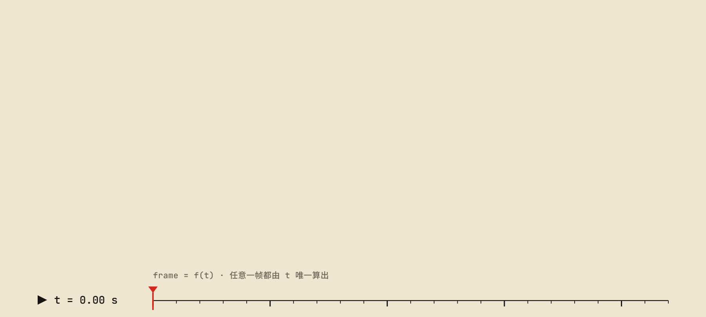

# f(t)



**自由软件，自由视频。** f(t) 用大语言模型协助制作讲清楚一件事的科普与项目介绍视频，并公开每部片子的事实依据、文案、审稿记录、动画源码与制作工具，以 GPL-3.0-or-later 发布。任何人都可以看、研究、修改，也可以拿去重新做一部。

名字来自画面本身：每一帧都是时间 t 的纯函数 f(t)。成片为 1920×1080、60 帧/秒，发布在 [哔哩哔哩](https://space.bilibili.com/68328330) 与 [YouTube](https://www.youtube.com/@waterrun1978)。全部作品、制作状态与发布记录见 **[片单](videos/README.md)**。

## 宗旨

知识是人类共同创造的财富，讲解知识的视频也应当像自由软件一样自由。每部片子连同它的全部源码一起发布，使用者享有四项自由：

| 自由 | 在 f(t) 里的含义 |
|---|---|
| 运行 | 任何人都可以为任何目的观看、放映、使用这些视频 |
| 研究 | 每一帧都是 f(t)，每一句旁白都有出处，每一个数字都能回到实验里重算 |
| 修改 | 改一句文案、换一种配色、纠正一个事实，然后重新出片 |
| 分发 | 原样或修改后再发布；分发改编作品时，按 GPL 一并提供源码 |

**以共产主义精神协作。** 知识共享，生产资料公开，各尽所能，劳动如实署名，改进回到公共。工具、方法和失败的教训都写下来，成为下一部片子的起点。人用本人选择的署名，模型写准确的型号；分工按实际贡献记录，不漏记，不冒领。

**内容大于形式。** 事实可靠、解释清楚、叙事连贯，比形式复杂更重要。画面、声音与技术为理解服务，好的文档让下一位参与者读得懂、查得了、接得上。

**开源是交付的一部分。** 自制、委托第三方或外部协作，都要交付可编辑源码、制作步骤与相应许可，不能只交一个 MP4。范围与交付方式见[开源交付与第三方许可](docs/reference/third-party.md)，完整的宗旨见[宗旨与原则](docs/principles.md)。

## 一部片子怎样做出来

1. **取证与文案。** 画面与旁白里的每一项事实都记在本片的 `research/FACTS.md`，能回到一手来源或实验。先写能通读的讲述，再拆字幕、安排镜头。
2. **本地审片页。** 文案初稿、5 个配音候选、3 个配乐小样和几个视觉方向的关键帧，放进一张本地 HTML 页面，策划者在一处看完、一次选定。
3. **确认后配音。** 文案经校对者明确确认才合成旁白。旁白逐句合成，取回每个词被读到的时刻；动画挂在「某句里的某个词」上，文案一改，画面自动重排。
4. **预览迭代。** 每一轮交出之前，制作方先做自对抗审查：把自己当成挑剔的观众和找茬的测试者，找出并修掉线压字、字被裁、名词没解释、读音不对这类问题。策划者的时间用来判断内容与审美，不浪费在简单的 Bug 上。
5. **正式片与发布。** 策划者同意后出正式片。发布后源码冻结，反馈提炼成经验规则，用在下一部。

技术上，每部视频是一段以 t 为唯一输入的 HTML 动画，不用 CSS 动画、定时器与回调；任意一帧都能独立渲染，多个无头浏览器并行出帧，再由 ffmpeg 编码封装。配乐与音效由程序合成，混音是确定性的。工具检查版面、规格与确定性；内容是否可靠、叙事是否清楚、声音是否合适，仍靠读稿、观看和试听判断。详见[制作周期](docs/process.md)。

## 仓库的结构

| 路径 | 层级 | 内容 |
|---|---|---|
| `docs/` | 仓库 | 宗旨、角色、制作周期、质量标准、经验规则、专题与参考，入口是[文档地图](docs/README.md) |
| `kit/` | 仓库 | 引擎、工具、新片模板、系列起点、回归测试 |
| `videos/<系列>/README.md` | 系列 | 每个系列一份说明：定位与共同约定 |
| `videos/<系列>/<片>/`、`videos/standalone/<片>/` | 视频 | 每部片子一个目录：简报、事实、文案、审稿、源码与交付记录 |

片单的唯一来源是 `videos/catalog.json`，[片单索引](videos/README.md)与 [Credit 盘点](videos/CREDITS.md)由工具生成。模型在这里工作，先读 [AGENTS.md](AGENTS.md)。

## 快速开始

需要 Git 与 Node.js 22.12 或更新；看画面另需 Chrome 与字体。下面的命令不调用在线配音，也不改动任何影片：

```bash
npm ci
npm test
npm run check:repo
npm run assets -- --fetch
npm run doctor -- --visual
npm run smoke
```

新建一部视频：

```bash
node kit/tools/new.js <片> --title "中文标题" --title-en "English title"
node kit/tools/new.js <片> --series <系列>          # 系列里的一集；片单里已有的条目取片单的标题
```

之后的步骤见[快速入门](docs/getting-started.md)与[制作周期](docs/process.md)。独立 fork 时，在 `kit/studio.json` 填写自己的策划、校对者与源码仓库。

## 许可

版权所有 © 2026 WaterRun。以 GNU 通用公共许可证第 3 版或（由使用者选择的）任何更新的版本发布，全文见 [LICENSE](LICENSE)。本仓库不提供任何担保。

第三方组件（GSAP、字体、ffmpeg、在线语音服务等）不随仓库分发，各自适用自己的许可，见[第三方组件与许可](docs/reference/third-party.md)。参与方式见 [CONTRIBUTING.md](CONTRIBUTING.md)。
