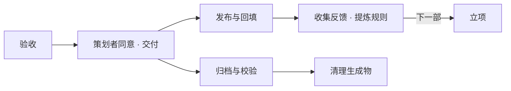

# 发布与收尾

验收之后还有五件事，各自记录、互不替代：交付、发布、收集反馈、归档、清理。发布可以晚于归档；清理完成不代表成片已验收；文件存在不代表已交付。



## 1. 交付

1. 验收完成（[验收](acceptance.md)），README 的「交付」写好，交给策划者看成片。
   同时按[开源交付清单](../reference/third-party.md#对应源码与发布材料)核对可编辑材料、GPL、参与者选定的署名、实际分工和对应版本的源码地址。第三方制作执行相同要求；只收到 MP4 不算完成交付。
2. 策划者看过并明确同意之后才登记交付：片单里本片的 `status` 改为 `delivered`，`project.json` 的 `stage` 改为 `delivered`，填 `delivery`（日期与各语言最终文件的实测时长），运行 `node kit/tools/catalog.js`。没有回复不算同意。
3. 交付前清掉不用的源码草稿、未接入的设计试验和调试内容；这一步在最后一次正式渲染之前做，渲染后再删 `src/` 里的文件会让成片过期。

## 2. 发布与回填

成片发布到哔哩哔哩（[空间](https://space.bilibili.com/68328330)）与 YouTube（[@waterrun1978](https://www.youtube.com/@waterrun1978)），按系列归入对应的合集。简介注明 GPL-3.0-or-later，给出本次成片的源码版本与必要外置材料的直达地址；第三方改编指向其实际修改版本。

发布之后把记录补回来，否则仓库与已经发生的事不一致：

- `project.json` 的 `release`：每个平台一条，`platform`、`url`、`date`，以及平台上的标题、语言（取自频道的公开页面，不凭记忆写）。`stage` 改为 `released`。
- 打开片尾「开源视频」指向的仓库地址，确认可以公开访问。
- 各语言是否都上了同一个平台、标题与简介怎么写，有差异如实记在 README。
- 运行 `node kit/tools/catalog.js`，片单索引随之更新。

未核实的平台写「未核」，不猜链接。仓库里没有回填的投稿可能已经存在，以平台上的实际链接为准。

### 发布后冻结

**已发布的成片及其制作源码冻结，只留反馈，警醒后人；只有策划者明确要求重做，才可以解冻。** 新反馈、新规则、评分不佳、发现漏署名，都不是自动重做的授权。不要自行把已发布片退回制作、改名单、改文案、重配音或重渲。

冻结范围包括 `src/`、事实与实验材料、配音素材、配乐脚本，以及 `project.json` 中影响制作结果的配置和 `credits`。漏署名时，在 README 的「评价与复盘」补记确认后的公开署名或模型型号、实际分工及依据。原 credits 与线上片尾保持一致，保留缺漏发生时的记录。

允许补登记确已发生的发布（链接、状态、已核日期等）和追加反馈记录；这不改变成片。策划者回报日与实际发布日期分开，未核的日期、标题或其他平台不猜。归档清理仍按本篇独立流程执行。

确实收到明确重做要求时，先在本片 README 记录策划者原话、日期、重做范围和原发布链接，再按变更影响重新走审稿与制作闸门，保留原发布版本的历史。此规则来自 2026-10-22 的 [P52](../log/feedback.md#2026-10-22发布后冻结未经明确要求不得重做)。

## 3. 收集反馈，提炼规则

反馈是下一部片子的起点。每次发布后、或策划者给出评价时：

1. **记原话**：策划者的评分与评价、评论区的主评论与楼中楼，记进 [反馈记录](../log/feedback.md)，编 P（策划者）或 C（评论）号，带日期、作品、成片时刻与来源链接；评论只保留必要短引，不收录评论者的账号资料。
2. **记到片子上**：评分写进 `project.json` 的 `reception`（`date`、`score`、`by`、`ref`）；README 的「评价与复盘」引用编号，并写这部片子做对了什么、做错了什么。
3. **提炼成规则**：按 [经验规则](../lessons.md) 的「反馈怎样变成规则」改 `docs/lessons.json`，能查的做进工具。
4. **已发布的片子按上节冻结**：新反馈落实在以后的片子上，旧片只留档；只有明确要求重做才能解冻。仍在制作、尚未发布的片子按当前授权和规则修改，不自动套用发布后的冻结。

评论不是事实依据。涉及事实的异议回到本片 `research/FACTS.md` 核查，写明成立、部分成立或不成立及依据（F09）。

## 4. 文件保留边界

| 内容 | Git | 归档 | 清理工具 |
|---|---|---|---|
| `project.json`、README、`src/`（含 timing）、`tools/`；旧片的 AGENTS、`brief/`、DELIVERY | 保留 | 拷贝本片版本 | 保留 |
| FACTS、已脱敏的实验脚本与证据、`review/` | 保留 | 拷贝 | 保留 |
| `audio/` 配音缓存与词边界数据 | 忽略 | 必须保留，在线重合成可能改变时长 | 校验归档后清理 |
| `out/` 成片、各音轨版本、字幕、封面、中间画面 | 忽略 | 全量拷贝 | 校验归档后清理 |
| `shots/`、`build/` 截图与检查报告 | 忽略 | 全量拷贝，保留复盘证据 | 校验归档后清理 |
| `research/_src/` 第三方源码与安装包 | 忽略 | 本工具跳过；FACTS 保留版本、来源与校验和 | 本工具保留，另按实验记录处理 |
| 根目录依赖、字体、`.venv/`、本机配置 | 忽略 | 按机器维护，不进入单片归档 | 不动 |

对旧文件的删除不能只按扩展名或「Git 忽略了」判断。实验回显可能也叫 `out_*.txt`，仍属于取证；`timing.*.js` 虽是生成文件，却是复现时间线必需的源码记录。

## 5. 预览清理范围

停止该片的配音、截图、扫描、混音与渲染任务，在生成物所在的机器上运行：

```sh
node kit/tools/clean.js videos/standalone/first-video
```

默认列出 `audio/`、`out/`、`shots/`、`build/` 的文件数和大小，不写归档、不删除文件。工具只接受一个明确的视频目录；拒绝根目录、越界路径、链接、junction、特殊文件，以及这些目录里任何 Git 已跟踪文件。

## 6. 归档校验后执行清理

选择仓库之外尚不存在的归档目录，预留至少本片源码与生成物总大小的空间。归档可在另一块磁盘；仅拷到同一块磁盘并不能防止该磁盘损坏。

PowerShell 示例：

```powershell
node kit/tools/clean.js videos/standalone/first-video --archive E:/VideoArchive/first-video-v1 --apply
node kit/tools/clean.js --verify E:/VideoArchive/first-video-v1
```

bash / zsh 示例：

```sh
node kit/tools/clean.js videos/standalone/first-video --archive /mnt/archive/first-video-v1 --apply
node kit/tools/clean.js --verify /mnt/archive/first-video-v1
```

工具按顺序：锁定本片 → 检查路径和 Git → 拷贝本片到归档的 `video/`（排除第三方源码与工作锁）→ 写 `manifest.json` → 校验归档全部文件的大小与 SHA-256 → 复查源目录没有变化 → 删除四个生成物目录内的已归档文件。任何归档或前置校验失败，都不开始删除；删除中遇到占用或变化会停止，完整归档仍保留。重复执行使用新的归档目录，不覆盖已有版本。

归档清单包含文件版本信息，不包含私人绝对路径。公开 README 只记录备份代号、清单哈希、校验日期和清理范围；具体存储位置留在本机。重要成片另备一份并抽验恢复，清理后回填状态。

## 7. 恢复和接续

1. 对归档运行 `clean.js --verify`。校验失败先找完整副本，不把损坏归档覆盖到工作目录。
2. 在独立位置检查 `video/project.json`、源稿与当前 Git 版本。如果是旧版归档，恢复到对应的源码版本或单独目录，不覆盖正在制作的新稿。
3. 将归档 `video/` 中所需的 `audio/`、`out/`、`shots/`、`build/` 复制到对应视频目录。源码、审稿记录和 `timing.*.js` 必须与这些文件是同一轮制作；有差异时按 workflow 的变更重做规则继续。
4. 重跑文案检查和相应制作检查。`check.js --final` 需要完整的输出与报告，清理后缺失是正常现象；先恢复，不能为通过而放宽检查。

单片归档保留影片的源文件和生成物，**不包含完整制作环境**。工具、依赖锁、字体与外部来源还须通过对应 Git 版本、assets 清单和交付中的环境记录恢复。在线重新配音不保证逐字节复现；保留原始音频比重新调用服务可靠。

## 8. 并行制作与异常退出

会写本片输出的 Node 工具使用 `.ft-work.lock`。同一片同时只能有一个写入任务；`preview → render` 这样的子工具复用父锁；不同视频可独立制作。锁不入库，正常退出自动释放。新建片单或修改共享文档时仍需协调，单片锁不负责串行化共享文件。

进程崩溃、强制中止或旧版工具可能留下异常状态。遇到锁时，先根据其中的 PID 核对该进程与其子进程是否仍在制作；确认都已退出后才移除本片这个锁文件。不能仅凭文件时间、PID 失效或目录前缀自动批量删除。外部编辑器、直接运行 Python、同步工具及旧工具不受锁保护，归档清理期间须暂停这些写入。

`doctor.js` 只报告系统临时目录中 `lvs-chrome-*` 的数量，不再提供批量删除。该目录可能属于另一部正在渲染的视频；定位本次进程的 `--user-data-dir`，确认没有存活的浏览器使用后，才处理那个已确认的目录。实验容器、数据库、镜像与 WSL 磁盘按各片实验记录撤除；本工具不清理全局缓存或其他项目。
