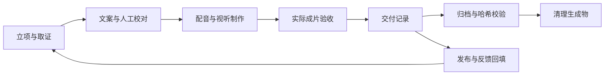

# 交付、归档、清理与恢复

完成制作包含四项独立记录：成片交付、平台发布、文件归档、工作目录清理。发布可晚于归档；清理完成也不代表成片已验收。每次停工和收尾更新本片 README 的当前状态。



## 1. 文件保留边界

| 内容 | Git | 归档 | 清理工具 |
|---|---|---|---|
| `project.json`、README、AGENTS、`src/`（含 timing）、`tools/` | 保留 | 拷贝本片版本 | 保留 |
| FACTS、已脱敏的实验脚本与证据、`review/`、`brief/`、DELIVERY | 保留 | 拷贝 | 保留 |
| `audio/` 配音缓存与词边界数据 | 忽略 | 必须保留，在线重合成可能改变时长 | 校验归档后清理 |
| `out/` 成片、各音轨版本、字幕、封面、中间画面 | 忽略 | 全量拷贝 | 校验归档后清理 |
| `shots/`、`build/` 截图与检查报告 | 忽略 | 全量拷贝，保留复盘证据 | 校验归档后清理 |
| `research/_src/` 第三方源码与安装包 | 忽略 | 本工具跳过；FACTS 保留版本、来源与校验和 | 本工具保留，另按实验记录处理 |
| 根目录依赖、字体、`.venv/`、本机配置 | 忽略 | 按机器维护，不进入单片归档 | 不动 |

对旧文件的删除不能只按扩展名或“Git 忽略了”判断。实验回显可能也叫 `out_*.txt`，仍属于取证；`timing.*.js` 虽是生成文件，却是复现时间线必需的源码记录。

## 2. 交付前整理

1. 清除已不用的源码草稿、未接入的设计试验和临时调试内容；有保留价值的设计解释放在 README。此步在最后一次正式渲染之前完成，渲染后删除 `src/` 文件也会使输出过期。
2. 完成所有语言的检查与成片复盘：事实、阅读时间、声音、字幕、片尾和封面。最终编码 MP4 的规格、响度、峰值须实际测量；旧混音报告不能代替。
3. 写明交付文件、哈希、软件版本、检查范围、实际没看或没听的部分、遗留项与重建命令。确认原始配音和审核截图的保存位置。
4. 更新片单与近期计划；投稿之后单独回填真实发布链接与反馈。不得将“已经有文件”写成“已验收”。

## 3. 预览清理范围

停止该片的配音、截图、扫描、混音与渲染任务，在生成物所在的机器上运行：

```sh
node kit/tools/clean.js videos/standalone/first-video
```

默认列出 `audio/`、`out/`、`shots/`、`build/` 的文件数和大小，不写归档、不删除文件。工具只接受一个明确的视频目录；拒绝根目录、越界路径、链接、junction、特殊文件，以及这些目录里任何 Git 已跟踪文件。

## 4. 归档校验后执行清理

选择仓库之外尚不存在的归档目录，预留至少本片源码与生成物总大小的空间。归档可在另一块磁盘；仅拷到同一块磁盘并不能防止该磁盘损坏。

PowerShell 示例：

```powershell
node kit/tools/clean.js videos/standalone/first-video --archive E:/VideoArchive/first-video-v1 --apply
node kit/tools/clean.js --verify E:/VideoArchive/first-video-v1
```

bash / zsh 示例：

```sh
node kit/tools/clean.js videos/standalone/first-video --archive /mnt/archive/first-video-v1 --apply
node kit/tools/clean.js --verify /mnt/archive/first-video-v1
```

工具按顺序：锁定本片 → 检查路径和 Git → 拷贝本片到归档的 `video/`（排除第三方源码与工作锁）→ 写 `manifest.json` → 校验归档全部文件的大小与 SHA-256 → 复查源目录没有变化 → 删除四个生成物目录内的已归档文件。任何归档或前置校验失败，都不开始删除；删除中遇到占用或变化会停止，完整归档仍保留。重复执行使用新的归档目录，不覆盖已有版本。

归档清单包含文件版本信息，不包含私人绝对路径。公开 README 只记录备份代号、清单哈希、校验日期和清理范围；具体存储位置留在本机。重要成片另备一份并抽验恢复，清理后回填状态。

## 5. 恢复和接续

1. 对归档运行 `clean.js --verify`。校验失败先找完整副本，不把损坏归档覆盖到工作目录。
2. 在独立位置检查 `video/project.json`、源稿与当前 Git 版本。如果是旧版归档，恢复到对应的源码版本或单独目录，不覆盖正在制作的新稿。
3. 将归档 `video/` 中所需的 `audio/`、`out/`、`shots/`、`build/` 复制到对应视频目录。源码、审稿记录和 `timing.*.js` 必须与这些文件是同一轮制作；有差异时按 workflow 的变更重做规则继续。
4. 重跑文案检查和相应制作检查。`check.js --final` 需要完整的输出与报告，清理后缺失是正常现象；先恢复，不能为通过而放宽检查。

单片归档保留影片的源文件和生成物，**不包含完整制作环境**。工具、依赖锁、字体与外部来源还须通过对应 Git 版本、assets 清单和交付中的环境记录恢复。在线重新配音不保证逐字节复现；保留原始音频比重新调用服务可靠。

## 6. 并行制作与异常退出

会写本片输出的 Node 工具使用 `.ft-work.lock`。同一片同时只能有一个写入任务；`preview → render` 这样的子工具复用父锁；不同视频可独立制作。锁不入库，正常退出自动释放。新建片单或修改共享文档时仍需协调，单片锁不负责串行化共享文件。

进程崩溃、强制中止或旧版工具可能留下异常状态。遇到锁时，先根据其中的 PID 核对该进程与其子进程是否仍在制作；确认都已退出后才移除本片这个锁文件。不能仅凭文件时间、PID 失效或目录前缀自动批量删除。外部编辑器、直接运行 Python、同步工具及旧工具不受锁保护，归档清理期间须暂停这些写入。

`doctor.js` 只报告系统临时目录中 `lvs-chrome-*` 的数量，不再提供批量删除。该目录可能属于另一部正在渲染的视频；定位本次进程的 `--user-data-dir`，确认没有存活的浏览器使用后，才处理那个已确认的目录。实验容器、数据库、镜像与 WSL 磁盘按各片实验记录撤除；本工具不清理全局缓存或其他项目。
