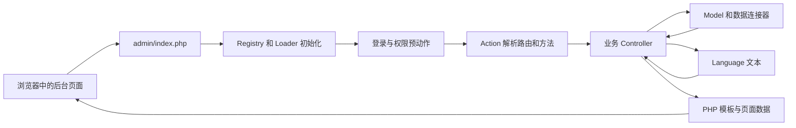
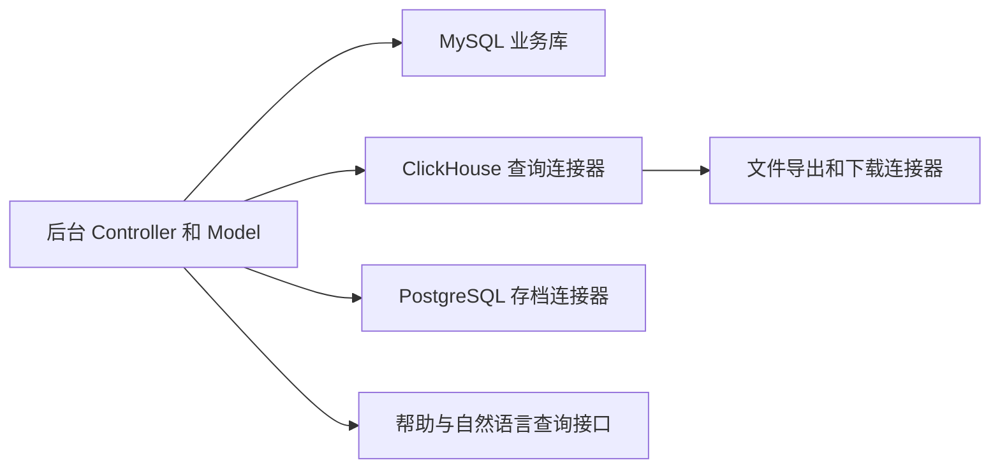

# 早期 OpenCart 后台全面测绘

测绘日期为 2026-10-09，对象是匿名案例 CASE-A 的本地源码快照。用途是为选题提供基础情况，不预设影片主线。所有案例文件路径均相对于应用目录，真实项目名、部署位置、人员和业务数据未随本文公开。

CASE-A 保留早期 OpenCart 的后台组织方式，但已扩展成仓储、订单、财务和绩效管理系统。当前源码里多个年代的页面同时存在。入口常量是 `1.4.9.3`，因此“OpenCart 1.5 时代”只能先作为历史观察范围，不能当作这个项目已核实的发行版本。官方 `1.5.6.4` 被单独取回作源码对照，完整继承关系仍待考证。

## 证据范围

本轮扫描应用跟踪文件的规模和编码，深入检查 27 个代表路由，建立 153 个源文件引用条目的清单，其中 147 个文件实际存在。另读取官方固定提交的 5 个源码文件。详细数字、行号和 SHA-256 见 [案例记录](lab/out_01_case_inventory.json) 与 [官方记录](lab/out_02_upstream_inventory.json)。

这里的“静态确认”指源码里的声明、引用或实现结构；它不证明对应功能已部署、被实际使用或业务结果正确。历史运维文档用于描述已记录的背景，没有转换成当天的生产实测结论。未连接生产数据库，未登录后台，也未进行在线截图或真实业务操作。

## 版本和时间层次

| 层次 | 已确认的材料 | 使用边界 |
|---|---|---|
| 案例版本标记 | `admin/index.php:206` 为 `1.4.9.3`；页尾控制器引用 `VERSION` | 常量可能长期保留，不能据此证明完整代码与官方该版本相同 |
| 官方对照 | OpenCart `1.5.6.4`，提交 `31323f8ce70338e88570217f76e1111f7b2bcc8f` | 代表这一个官方快照，不概括所有 1.5 小版本 |
| 共同框架特征 | 路由到控制器类、登录和权限预动作、PHP 模板展开 | 支持结构相似的判断，不能单独证明从哪个版本直接分叉 |
| 案例长期业务扩展 | 采购、库位、扫码、称重、财务、绩效等模块 | 属于此案例，不自动归于原版 OpenCart |
| 近期改造 | 列存查询、导出服务、帮助问答、局部 Vue 工程等 | 不放进“当年的原版能力”叙述 |

官方对照入口在 [固定提交的后台入口](https://github.com/opencart/opencart/blob/31323f8ce70338e88570217f76e1111f7b2bcc8f/upload/admin/index.php)，界面骨架在 [页头模板](https://github.com/opencart/opencart/blob/31323f8ce70338e88570217f76e1111f7b2bcc8f/upload/admin/view/template/common/header.tpl)。本轮未认定案例的首次上线年份，也没有把本地 Git 建库时间当作系统诞生时间。

## 代码规模和目录

统计对象是应用目录中的 Git 跟踪路径，不包含工作区临时证据或未跟踪文件。

| 项目 | 本轮值 | 解释 |
|---|---:|---|
| 应用跟踪文件 | 50,660 | 含图片、第三方 SDK 和历史副本 |
| PHP 文件 | 10,767 | 不能等同于自研业务规模 |
| `.tpl` 文件 | 1,436 | 含历史目录 |
| `admin/controller` 下 PHP | 2,782 | 包含 SDK；词法扫描仅匹配到 529 个继承 Controller 的类声明，仍含副本 |
| `admin/model` 下 PHP | 766 | 文件数量，不是数据库表数 |
| 当前后台模板目录下 `.tpl` | 1,257 | 不代表全部页面都能运行 |
| `admin/old` 跟踪文件 | 1,838 | 独立保留的旧目录，不据此判断当前入口会调用它 |
| 含 `<script>` 的模板 | 1,202 / 1,436 | 标签存在性统计，不证明脚本实际执行 |
| 含 `$(` 的模板 | 1,255 / 1,436 | jQuery 风格调用的词法标记，不是独立依赖检测 |
| 非合法 UTF-8 的 PHP 或模板 | 25 | 保留字节，不批量转码或修改 |

`admin/` 承载主后台，`system/engine/` 是小型框架核心。`image/` 有 26,361 个跟踪文件，`zhongzhuan/` 有 12,576 个，单看仓库总数很容易高估业务代码量。`print/`、`cmd/`、`erpapi/`、`azpda/`、`tmapi/` 等还存在独立功能入口或接口材料。因此 `admin/index.php` 是后台主入口，不宜写成整个工程只有一个可执行入口。

应用顶层当前没有 `index.php` 或 `catalog/` 目录，不能套用原版完整商城的前台目录图。

## 一次后台请求如何组织

入口在初始化后注册登录与权限预动作，再分派 `route`。Action 将路径映射到控制器文件和类，剩余路径段用于方法名；没有方法段时采用 `index`。模板通过 `extract($this->data)` 和 `require` 生成响应。依据为 `admin/index.php:266,431,434,444`、`system/engine/action.php:39,64,80`、`system/engine/controller.php:148,154`。

这是一套以服务器渲染 PHP 模板为主、夹杂页内脚本和 AJAX 的后台。`frontend/package.json` 另有 Vue 3 与 Vuetify 依赖声明，Vite 输出指向 `admin/Lib/vueapp`。它是局部工程，不能把整个后台归为 Vue 单页应用。

## 菜单和业务地图

下表是功能覆盖索引。业务顺序是据模块职责组织的理解方式，尚未逐环节验证事务、账务规则或业务闭环。

| 业务域 | 代表入口 | 可观察的工作 |
|---|---|---|
| 登录和工作台 | `common/login`、`common/home` | 登录、进入工作区、查看概况 |
| 商品和库存 | `catalog/product`、`catalog/stock`、`catalog/outstock` | 商品列表、库存相关操作与查询 |
| 库位和批量作业 | `catalog/kuweigl`、`catalog/batchstock` | 库位维护、条码或批量入库相关操作 |
| 采购和到货 | `office/procurement_plan`、`office/instock` | 采购计划、到货与入库登记 |
| 订单和出入库记录 | `sale/order`、`sale/stockhistory` | 订单或出库相关列表、入库记录、筛选和详情 |
| 计提和财务 | `sale/orderjt`、`sale/stockhistoryjt`、`caiwu/orderlistprint` | 计提相关记录、财务汇总或对账页面 |
| 称重和物流 | `wuliuweight/weight`、`wuliuweight/weightlist` | 称重操作、记录和物流字段 |
| 绩效和工资 | `query/warehouse_salary_query`、`query/order_salary_query` | 仓库岗位、打单岗位的查询与存档 |
| 用户和权限 | `user/user`、`user/user_permission`、`setting/setting` | 用户、用户组和配置 |
| 近期记录查询 | 六个列存路由，见下节 | 入库、出库、计提、称重和订单查询 |
| 外部对接和现场入口 | 菜单及接口目录 | 平台订单、物流、打印和 PDA 等；本轮未逐接口展开 |

菜单模板存在多处分组条件，还存在新旧页头。页头控制器会按部分路由和会话中的菜单版本选择模板。不能把某一用户看到的菜单当成全部菜单，更不能从菜单分支数量推算真实用户组数量。

全局入口具有登录、令牌和权限检查；页内又能看到不同的金额、字段和导出权限方法。实际角色名称、用户组分配和线上配置未读取，不能据此宣称权限完全一致或访问控制已通过验收。

## 页面呈现和交互层次

| 层次 | 源码样本 | 已确认的结构 | 展示时的标注 |
|---|---|---|---|
| 官方 1.5 对照 | 官方 `header.tpl` 与 `sale/order_list.tpl` | 多级菜单、表单、筛选行、表格和分页；页头引用 jQuery 1.7.1、jQuery UI、Superfish | 官方 1.5.6.4 源码对照；尚无运行截图 |
| 案例旧式业务列表 | `sale/order_list.tpl`、`catalog/product_list.tpl` | 表单、密集表格、筛选和分页，含 jQuery 风格调用 | 长期改造案例，不能直接标为官方原版 |
| 案例公共界面 | 两套页头、登录页和首页 | 页头按条件加载不同版本 jQuery；当前登录与首页为现有实现 | 不把当前登录页自动当作历史原貌 |
| 后来的记录查询页 | `*_record_clickhouse.tpl` 等 | 条件查询、AJAX、服务状态、导出及帮助问答实现 | 后续改造层 |
| 后来的绩效页面 | 两个 salary query 模板 | 查询、编辑或存档相关的较大模板 | 业务扩展层；全部工资数据使用合成示例 |

旧公共样式表使用 Arial 等字体，基础字号有 12px，存在 `.box`、`.list`、`.filter`、`.pagination` 等样式。它可以解释源码组织与高密度列表的设计方式，但真实浏览器中的尺寸、滚动和遮挡仍需运行后核对。

当前计提记录模板有 8,317 行、462,529 字节，旧 `sale/order_list.tpl` 是 463 行、29,253 字节。这是两份现存文件的体积对照，不能据此推导性能差异、代码质量或开发时间。近期模板仍能找到 jQuery 调用，旧交接文档中的“新页无 jQuery”不能直接沿用。

## 数据和外围依赖

图中只表示代码依赖，不表示服务已经连通，也不描述生产网络位置。同步器、下载服务和其他外围服务的独立仓库未在本轮展开。

| 部分 | 代码证据 | 已确认与边界 |
|---|---|---|
| MySQL | 老业务模型和数据库引导 | 传统业务读写路径存在；未读取实际库表、数据量或执行计划 |
| ClickHouse | `utils/ClickHouseConnector.php`、记录查询模型 | 列存查询与导出依赖存在；数据新鲜度、一致性和实时性能未测 |
| PostgreSQL | `query/ordersalaryquery.php` 引用对应连接器，并实现存档方法 | 支撑绩效页的存档逻辑；实际存档内容未取样 |
| 下载服务 | `utils/YYDownloaderConnector.php`、ClickHouse 导出路径 | 文件地址签名与打包方法存在；没有生成真实下载链接 |
| 帮助问答 | 近期控制器的 `helpChat`、`naturalQuery` 等方法 | 存在集成代码；模型服务可用性和发送内容未在本轮调用验证 |
| 平台和物流接口 | 菜单、SDK、独立接口目录 | 有长期对接材料；目录存在不等于目前仍启用 |

列存相关样本是五类页面、六个路由：入库 `sale/stockhistory_record_clickhouse`；出库 `sale/order_record_clickhouse`；计提的 `sale/accrual_record_clickhouse` 与 `caiwu/accrual_record_clickhouse` 两套；称重 `wuliuweight/weight_record_clickhouse`；订单 `sale/order_clickhouse`。本轮只确认它们在工作区的实现，不将两套计提当作同一个文件或同一部署状态。

## 环境和复现条件

| 环境材料 | 已有依据 | 本轮状态 |
|---|---|---|
| 本地应用快照 | Git 跟踪源码与逐文件哈希 | 已扫描，未启动应用 |
| 开发容器 | Dockerfile 声明 PHP 5.6 Apache；Compose 声明 MySQL 5.5 和 Redis 5 | 配置静态信息，未验证运行中的镜像 |
| 历史生产环境 A 和 B | 交接文档记录 PHP 5.2.11 与 5.6.40，手工发布 | 历史文档背景，未重新登录生产核验 |
| 仿真环境 | 2026-09 的文档记录 PHP 5.2.17、最小种子库及外围服务隔离 | 可作后续候选；当前隔离状态和数据状态未复测 |
| 官方 1.5.6.4 | 固定提交的 5 个文件 | 已取回并核对源码；未安装或渲染 |

仿真文档明确其种子库并非生产全量复刻，部分旧资产不全。它适合后续兼容性验证，但不足以直接得到所有业务页面的完整演示。运行私有案例前应核对每个连接器的目标，使用合成库和明确隔离的外围接口，避免把“本地打开”误当成“全部数据来自本地”。

## 已发现的缺口

1. 原项目到底基于哪份完整 OpenCart 发行包、之后怎样合并或移植，尚未证明。保留版本标记和结构相似只是证据的一部分。
2. 当前 27 个样本控制器均存在，但六个引用文件缺失：`admin/model/office/new.php`、`admin/view/template/catalog/cancelproduct.tpl`、`admin/view/template/office/new.php`、`admin/view/template/sale/importswl_form.tpl`、`admin/view/template/sale/orderjt_form.tpl`、`admin/view/template/sale/orderjt_invoice.tpl`。缺失分支是否仍可到达尚未验证，不能直接称为六个线上故障。
3. 菜单还有样本外的路由，未逐个核对动态分派、权限、模板和外部模块。此次页面地图是代表性覆盖，不是全系统逐页验收。
4. 业务金额口径、退货与冲正逻辑、跨仓一致性、工资规则、同步延迟等尚未做数据验证。历史审计发现不等于当天仍有同一问题，也不等于已经解决。
5. 未取得可公开的运行截图。源码推导出来的示意界面必须明确标“示意”，不能包装为生产实录或历史截图。

## 可供后续选题使用的材料

| 观察方向 | 已有材料 | 选定后需补的证据 |
|---|---|---|
| 早期管理后台的操作方式 | 官方菜单、列表和分页源码；案例页面地图 | 干净官方环境或有明确标注的重建界面 |
| 后台如何扩展为仓储工具 | 采购、库位、称重、计提和绩效模块 | 一条合成业务流程的完整运行记录 |
| 老框架中逐步加入新能力 | 新旧模板、列存连接器、导出和问答接口 | 控制变量的演示及依赖隔离核验 |
| 维护长期运行系统的约束 | 版本差异、缺失引用、混合编码、历史部署文档 | 相应范围的复现实验，不能据文件量直接下评价 |

以上方向尚未选定。后续先明确一个主问题，再按问题选择页面和补证；当前全部测绘材料保留在研究层，不直接排列成影片章节。
